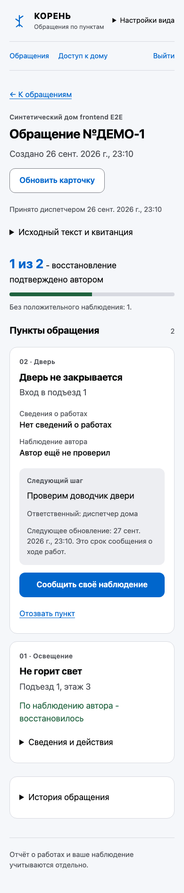
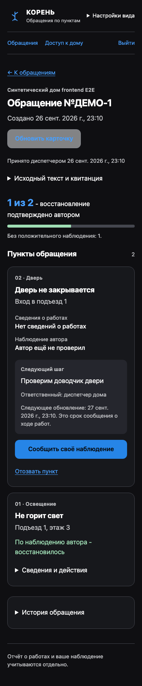

<p align="center">
  
</p>

<h1 align="center">ДомПульс</h1>

<p align="center">
  <a href="https://github.com/coder-smookki/VkEducation-and-MessangerMax-Hackathon-2026/actions/workflows/ci.yml"></a>
  
  <a href="#запуск-в-docker"></a>
  <br>
  
  
  
  
  
  
  
  
  
  
  
  
  
  <a href="#запуск-в-docker"></a>
  <br>
  <a href="#лицензия"></a>
</p>

<p align="center">
  Mini App и текстовый бот в мессенджере MAX для обращений жильцов, в которых сразу несколько бытовых проблем. Автор получает список отдельных пунктов, исправляет и подтверждает его; диспетчер принимает обращение, назначает следующий шаг, сохраняет отчёт о работах и явно связывает его с конкретными пунктами; автор отдельно сообщает, что видит сам. Частичный ответ не теряет вторую проблему: «Лампу заменили» не закрывает дверь
</p>

<p align="center">
  <a href="docs/README.md"><b>Документация</b></a> ·
  <a href="#запуск-в-docker"><b>Запуск в Docker</b></a> ·
  <a href="docs/api.md"><b>API</b></a> ·
  <a href="DATA-API.yaml"><b>DATA-API</b></a> ·
  <a href="docs/release.md"><b>Выпуск</b></a>
</p>

Решение для хакатона VK Education и мессенджера MAX, 2026. ДомПульс - видимое название Mini App; внутреннее ядро, Java/Python-пакеты, схема БД и серверные контракты называются КОРЕНЬ.

## Скриншоты

<p align="center">
  
  
</p>

<p align="center">
  Ранняя версия интерфейса от 26.09, до оформления ДомПульс: снимки браузера над настоящим Java/PostgreSQL, синтетическое обращение. Это не снимки клиента MAX (<a href="docs/qa/kirill-2026-09-26.md">протокол</a>). Проектный прототип 22.09 - <a href="design/index.html">исторический каталог</a>
</p>

## Что умеет

Автор описывает несколько бытовых проблем одним сообщением. Он получает понятный список, исправляет и подтверждает его. Диспетчер принимает обращение, указывает следующий шаг для конкретной проблемы, сохраняет отчёт и явно связывает его с нужными пунктами. Автор отдельно отмечает наблюдение: «Всё в порядке», «Проблема осталась», «Не могу проверить». По оставшимся пунктам видны ответственный, действие и время следующего обновления ([продукт и границы MVP](docs/product.md)).

- Текстовый бот MAX и Mini App используют одно состояние: бот вызывает те же application-команды Java и ту же PostgreSQL
- Сообщение о работе, наблюдение автора и административное решение - три независимые сущности; сохранение отчёта, связь отчёта с пунктом, наблюдение и архив - разные команды
- Python-сервис RULES возвращает необязательные подсказки по отчёту с ручным подтверждением связи; при недоступном Python работает ручной путь
- Извлечение пунктов из свободного текста пока STUB: автор составляет список вручную. Похожие обращения на Kafka/Chroma написаны, но в release выключены

## Что где

| Что | Где |
|---|---|
| Mini App | [frontend/](frontend): React, TypeScript, Vite; бренд ДомПульс в [frontend/public/brand/](frontend/public/brand) |
| Основной backend | [backend/](backend): Java, Spring Boot, PostgreSQL, миграции Flyway; вход MAX, бот, права, команды |
| Анализ отчётов | [ml/](ml): Python, FastAPI; RULES-подсказки, производный индекс Chroma из Kafka |
| Межкомпонентные договорённости | [contracts/](contracts/README.md) |
| Сценарная проверка API | [DATA-API.yaml](DATA-API.yaml) |
| Документация | [docs/](docs/README.md): продукт, домен, архитектура, API, разработка, приёмка, выпуск, журнал |
| Проектный прототип | [design/](design): редактируемый прототип и изображения с синтетическими данными |
| Выпуск | [compose.release.yaml](compose.release.yaml), [frontend/Dockerfile.release](frontend/Dockerfile.release), [frontend/nginx.conf](frontend/nginx.conf), [deploy/](deploy) |
| Скрипты проверки и обслуживания | [scripts/](scripts) |
| CI | [.github/workflows/ci.yml](.github/workflows/ci.yml) |

`output/` - локальные внутренние материалы, не публичная поставка. Документация не содержит токена бота и закрытых исходников конкурса.

## Запуск в Docker

Нужен только Docker с Compose (Java, Node и Python собираются в контейнерах). Из корня репозитория:

```sh
cp .env.example .env && docker compose up --build -d
```

Первая сборка скачивает зависимости и занимает несколько минут; повторная - быстрее. Секреты в `.env.example` - только учебные (`DB_PASSWORD=koren_local_only`), токена бота там нет и для локального запуска он не нужен.

| Что | Адрес | Ожидаемый ответ |
|---|---|---|
| Mini App (Vite) | http://127.0.0.1:5173 | страница приложения; рабочие экраны просят вход через MAX |
| Java API, здоровье | http://127.0.0.1:8080/actuator/health | `{"status":"UP"}` |
| Java API без входа | http://127.0.0.1:8080/api/v1/me | `401`, problem+json с `code: AUTH_REQUIRED` и `requestId` |
| PostgreSQL | 127.0.0.1:5432 | база `koren`, пользователь `koren` |

Все порты открыты только на `127.0.0.1`. Python-сервис анализа доступен лишь внутри сети Compose. Kafka не нужна для основного сценария и включается отдельно: `docker compose --profile similar up -d`.

Проверка одной командой после запуска: `python3 scripts/smoke.py` - печатает `PASS: …`, если frontend, прокси, Java и Python отвечают, а рабочие маршруты требуют сессию.

Основные переменные `.env` (полный список с пояснениями - в `.env.example`):

| Переменная | Для чего | Локально |
|---|---|---|
| `DB_USER`, `DB_PASSWORD`, `DB_NAME` | PostgreSQL | как в примере |
| `MAX_BOT_TOKEN`, `MAX_WEBHOOK_SECRET` | вход через MAX, бот, webhook | пусто: бот и вход выключены |
| `MAX_BOT_NAME` | ссылки «Открыть приложение» из бота | `t109_hakaton_max_bot` |
| `MAX_WORKERS_ENABLED`, `ANALYSIS_ENABLED`, `KAFKA_ENABLED` | фоновые воркеры, анализ, Kafka | `false` |
| `CASE_NUMBER_PREFIX` | подпись номера, например `ДЕМО-` для синтетических данных | пусто |

Остановка и перезапуск:

```sh
docker compose down            # остановить; данные базы сохраняются в томе
docker compose up -d           # запустить снова без пересборки
docker compose logs -f backend # журнал Java, в каждой строке id запроса
docker compose down -v         # остановить и УДАЛИТЬ данные базы
```

## Воспроизводимая проверка Mini App

Нужны Docker Compose, Node.js 24 и Python 3. Из корня:

```sh
npm --prefix frontend ci
(cd frontend && npx playwright install chromium)
python3 scripts/check_miniapp.py
# Тот же изолированный стенд с настоящим Python RULES и проверкой анализа:
python3 scripts/check_miniapp.py --analysis
```

Команда собирает отдельный стенд Java/PostgreSQL/static frontend без demo, проходит четыре браузерных сценария и удаляет только свои временные контейнеры и данные. Использует случайный **тестовый** ключ для подписи initData; настоящего пользователя MAX не подменяет на публичном сервере. На Linux для Chromium могут понадобиться зависимости: `npx playwright install --with-deps chromium` из `frontend/`.

Для UI-проверок: `npm --prefix frontend test`. Для сборки: `npm --prefix frontend run build`. Подробности - [development](docs/development.md).

[DATA-API.yaml](DATA-API.yaml) содержит 24 проверки в официальном формате 1.0: от создания до отчёта, связи, авторского наблюдения и результата 1/2. Официальный валидатор даёт exit 0 с предупреждениями о внешних доступах/параметрах; отдельная локальная проверка нового комплекта - 145/145 PASS. [Команды проверки и новый вход оценщика](docs/qa/data-api.md): валидация файла не исполняет HTTP; самостоятельный доступ организаторов ещё нужно согласовать.

## Технологии и границы

Java - единственный владелец команд, прав и PostgreSQL. Python возвращает проверяемые подсказки; производный индекс не даёт полномочий. React/TypeScript используют один Java API с ботом. Версии зависимостей закреплены существующими POM/lock-файлами ([backend/pom.xml](backend/pom.xml), [frontend/package-lock.json](frontend/package-lock.json), [ml/uv.lock](ml/uv.lock)). Kafka/Chroma уже есть в dev, но не должны блокировать основной ручной путь.

## Домен и выпуск

Стенд публиковался по единственному публичному адресу `https://hackathon.lumnex.ru/`. MAX открывал его как Mini App; `/api/v1/` на этом же домене направлялся в Java. Токен бота остаётся на сервере. Файлы `compose.release.yaml`, `frontend/Dockerfile.release`, `frontend/nginx.conf` и `deploy/` обеспечивают этот запуск. `compose.release.yaml` применяется **отдельно**, не поверх учебного `compose.yaml`. На 16.11.2026 имя `hackathon.lumnex.ru` в DNS не находится, поэтому ссылки на стенд даны без перехода.

Бот: [@t109_hakaton_max_bot](https://max.ru/t109_hakaton_max_bot), запуск Mini App в MAX - `https://max.ru/t109_hakaton_max_bot?startapp`; без стенда бот не отвечает. Java проверяет initData и выдаёт сессию; `/me` возвращает действующие дома/роли и необязательный профиль. Формы отправляют предметные команды с CSRF, версиями и ключом идемпотентности, после успеха читают серверное состояние. Если данные запуска MAX устарели, Mini App просит скопировать незаписанный текст, закрыть приложение и снова открыть его кнопкой бота. Обновление страницы не создаёт новые данные входа; серверная проверка срока initData остаётся прежней. Текстовый бот вызывает те же application-команды и PostgreSQL; `/start` показывает команды, предупреждение про 112 и кнопку открытия Mini App. Карта экран → запрос → обработчик - [frontend-handoff](docs/frontend-handoff.md).

Страница «О сервисе» (`/#/about`) реализована для доступа до входа и из профиля: она описывает используемые данные, ограничения сервиса и запрос удаления через **smookki@yandex.ru**. Архив, отзыв и выход не удаляют данные; автоматического удаления и обещанного срока обработки нет. При опасности нужно звонить 112, не ждать ответа в приложении. Доступность страницы в опубликованной версии сверять по журналу выпуска.

Release-переменная `TRAINING_MODE=true` передаёт `VITE_TRAINING_MODE=true` в сборку web и показывает баннер «Учебный дом, данные тестовые». Смена этого флага требует пересборки web. `CASE_NUMBER_PREFIX` отдельно передаётся Java и задаёт только подпись номера. Флаг и префикс не подставляют обращения и не обходят вход.

В приложении нет подставных обращений или выдуманного успеха. Существующие тестовый дом и 3 обращения на стенде сохранены по решению пользователя; новые QA-данные создаются в отдельной временной БД. Извлечение пунктов из свободного текста ещё STUB: автор составляет список вручную. RULES для отчёта - необязательная подсказка, а не подтверждение ремонта; похожие обращения с Kafka выключены в release. Инструкция эксплуатации, ролей и ограничения HTTP/TLS - [release.md](docs/release.md), фактические обновления - [журнал](docs/operations-log.md).

Для «Подключить дом» нужен **отдельный одноразовый код приглашения**. UUID из таблицы seed - ID дома и не подходит для этого поля. Коды передаются приватно; после использования нужен новый. [Разбор и проверка](docs/qa/invitations-2026-09-29.md).

## Состояние и история выпусков

**Опубликовано 30.09:** web `c2464f1`, backend `530c36a`, ml `e569da6`. Интегрирована читаемость Семёна, исправлены меню при вводе/крупном тексте и медленное нажатие. UI 82/82, настоящий изолированный Java/PostgreSQL/Python 6/6, CI 6/6 и публичные проверки 16/16. [Выпуск, FAIL и границы](docs/qa/readability-webview-2026-09-30.md). Все данные/роли и env сохранены; физический MAX и самостоятельный доступ комиссии остаются открытыми.

**История 30.09 до выпуска читаемости:** поиск показывает найденный пункт/исходный текст; диспетчер имеет отдельную очередь с фильтрами Java и без создания обращения на главной. UI **77/77**, настоящий изолированный Java/PostgreSQL/Python `--analysis` **6/6**, 54 снимка. [Поиск и очередь](docs/qa/search-dispatcher-2026-09-30.md). Предыдущий выпуск форм/cookies опубликован: backend/web `530c36a`, CI 6/6, публичные проверки 16/16; Java 238 PASS + 2 SKIP. [Публикация и реальные оставшиеся проверки](docs/qa/ui-cookies-2026-09-30.md). Web `0755638` опубликован, backend `530c36a` и ml `e569da6` сохранены; HTTPS/внешние проверки 16/16.

**История 29.09, 23:12 МСК:** backend/ml `e569da6`, web `e4a7b3b`; опубликована подсказка для приглашений, CI 6/6, внешние проверки 16/16. Роли команды проверены: Кирилл - житель А, Семён - диспетчер А, Софья - житель Б; лишних прав нет. [Проверка](docs/qa/invitations-2026-09-29.md), [выдача ролей и доступ организаторов](docs/roles-and-review-access.md). После прежней согласованной очистки новые данные сохраняются.

**Обновление комплекта 28.09, 12:59 МСК:** `55bc3ff` отправлен в `dev` и на сервер; [CI 6/6](https://github.com/coder-smookki/VkEducation-and-MessangerMax-Hackathon-2026/actions/runs/36406237886), внешние проверки 16/16, данные сохранены. Изменились DATA-API, контракт/производные типы и документация. Исполняемый код тот же, поэтому `/actuator/info` по-прежнему сообщал честный runtime SHA `894243a`. [Протокол](docs/qa/data-api.md#публикация-комплекта-2809).

Задачи от 28.09: [план Семёна по DATA-API](docs/team/semyon-data-api.md), [план Кирилла по RULES](docs/team/kirill-rules.md), [локальный полигон для Claude/Codex](docs/qa/playground.md). Исправления RULES v3 и защита старых подсказок описаны в [протоколе](docs/qa/rules-v3-2026-09-28.md); они опубликованы согласованно в `57924c6`; независимый языковой holdout ещё не выполнен.

Локальная QA 28.09: [проверки, найденные дефекты и исправления](docs/qa/local-playground-2026-09-28.md). Java 235 PASS + 2 SKIP, Python 195 PASS + 1 SKIP, UI 71/71; настоящий изолированный стек 6/6 с Python и 4 PASS + 2 SKIP без него. Это не приёмка физического MAX/G2; артефакты и снимки сохранены вне Git.

**Состояние на 28.09.2026, 02:22 МСК:** опубликован `894243ac5c137affd908bb2992c1ee9be1dd4bd7` из `dev`, PR #15 Семёна принят с сохранением прежних исправлений. **[CI 6/6 jobs](https://github.com/coder-smookki/VkEducation-and-MessangerMax-Hackathon-2026/actions/runs/36358029171), public smoke 16/16 PASS**. Java integration 238/238, UI 71/71, Python 195 PASS + отдельный Kafka replay PASS; Mini App 6/6 с анализом и 4 PASS + 2 analysis SKIP без него. Два изолированных DATA-API сценария: **81/81 PASS**; runner control tests 17/17.

[Протокол выпуска 28.09](docs/qa/pr15-release-2026-09-28.md): все 3 обращения и аудит сохранены, backend обновлён после backup/restore-check, история коллег объединена, удалены 14 слитых веток. Остались dev/main. Реальный MAX/G2, независимая приёмка, доступ оценщика и финальная заморозка ещё открыты. DAPI-04 и локальная проверка DAPI-05 завершены. [Текущее состояние](docs/memory/PROJECT_STATE.md), [журнал](docs/operations-log.md), [остаток QA](docs/qa/readiness-update-2026-09-28.md). Документационный HEAD может отличаться от SHA runtime. HTTPS self-route хоста и DNS-продление исправлены 28.09 ([протокол](docs/qa/tls-2026-09-28.md)); порт 80 по поручению пользователя не менялся.

## С чего начать разработку

1. Человеку или агенту: [AGENTS.md](AGENTS.md), затем [навигатор документации](docs/README.md).
2. Выбрать задачу и владельца в [плане](docs/plan.md). Команда: [Семён - Java/Python](docs/team/semyon.md), [Кирилл - frontend](docs/team/kirill.md), [Софья - качество](docs/team/sofia.md).
3. Перед кодом прочитать [предметные правила](docs/domain.md), [API](docs/api.md), [пять контрактов](contracts/README.md).
4. Перед интерфейсом: [действующий дизайн](docs/design.md), [экраны и backend](docs/screens.md). [Каталог 22.09](design/index.html) сохранён как исторический прототип.
5. Запуск и команды: [разработка](docs/development.md). Приёмка: [сценарии](docs/acceptance.md), [проверки](docs/testing.md).

## Команда

| Участник | Роль | GitHub |
|---|---|---|
| Ильин Кирилл | Frontend, оформление MAX, сборка и выпуск, интеграция документации | [@coder-smookki](https://github.com/coder-smookki) |
| Семён | Backend Java/Python, SQL, вход и бот MAX, API и безопасность | [@S1notik](https://github.com/S1notik) |
| Софья | Приёмка, тестовые сценарии и независимая проверка | - |

## Лицензия

© 2026 Ильин Кирилл Русланович. Все права защищены.

«ДомПульс» распространяется под проприетарной лицензией, полный текст - в [LICENSE](LICENSE). Коротко:

- можно смотреть код на GitHub и запускать опубликованные сборки только для личного ознакомления
- нельзя использовать решение в коммерции и в собственных целях, копировать, изменять, распространять, переносить код в другие проекты и обучать на нём модели без письменного разрешения автора
- условия действуют бессрочно, весь срок действия исключительного права
- сторонние библиотеки, модель all-MiniLM-L6-v2, которую ChromaDB загружает по умолчанию, и Docker-образы остаются под своими лицензиями (MIT, Apache-2.0 и другими, см. [backend/pom.xml](backend/pom.xml), [frontend/package-lock.json](frontend/package-lock.json), [ml/uv.lock](ml/uv.lock) и раздел 5 [LICENSE](LICENSE))

Для разрешения на использование - [@coder-smookki](https://github.com/coder-smookki).
