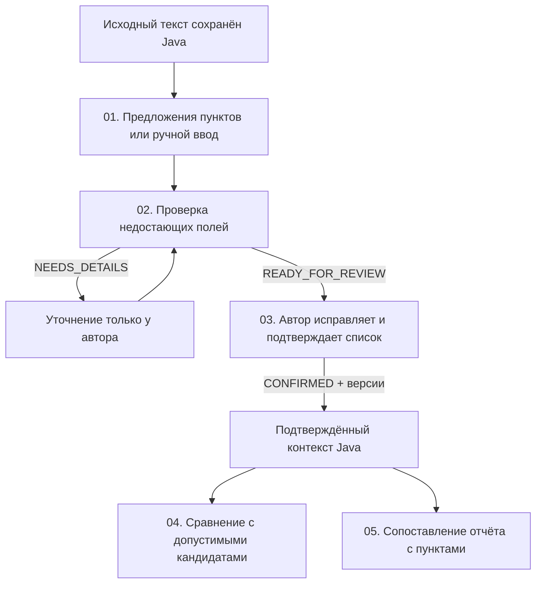

# Пять контрактов обработки обращения

Обновлено: 13.09.2026. Основание - уточнение Кирилла: система предлагает отдельные проблемы, автор исправляет/подтверждает список, дальнейший анализ получает подтверждённую версию. Уточнения адресованы только автору. Для похожих обращений подготовлен протокол без подключения моделей и векторизации.

| № | Контракт | Направление | Что действительно работает сейчас |
|---|---|---|---|
| 01 | [Предложение пунктов](01-extract-items.md) | Java → Python → Java | HTTP, типы, валидация, STUB; извлечения текста ещё нет |
| 02 | [Уточнение у автора](02-author-clarification.md) | Java → Python → Java → автор | Проверка недостающих полей и шаблоны вопросов RULES; отправки MAX/UI ещё нет |
| 03 | [Правка и подтверждение](03-author-review.md) | Автор/React → Java | OpenAPI и проверяемые примеры будущего API; endpoints ещё закрыты |
| 04 | [Похожие обращения](04-similar-cases.md) | Java → Kafka/Chroma → Python → Java | Поиск кандидатов ML в Chroma и проверка границ |
| 05 | [Отчёт по пунктам](05-report-comparison.md) | Java → Python → Java | Прежний совместимый `/compare`, STUB и ручной fallback |

Номера 01-05 - каталог предметных контрактов. Организационные C1-C4 из [плана параллельной работы](../docs/parallel-development.md) сохраняют свои значения: 03 относится к C1; 01/02/04/05 - к C3, а доставка автору - к C4.

## Порядок и уровни готовности



Это схема целевого пользовательского процесса, а не заявление о готовом CRUD/MAX. Не отправлять все обращения через пять вызовов подряд: 02 нужен при проверке черновика, 04 - при запросе поиска, 05 - при наличии отчёта. Сохранение Java не зависит от успешного ML-вызова.

- `NEEDS_DETAILS`: у предложения отсутствует category/location/symptom. Неизвестное поле явно null.
- `READY_FOR_REVIEW`: обязательные поля заполнены, автор ещё должен проверить список. Это не готовность ремонта.
- `CONFIRMED`: Java сохранила подтверждённую автором версию всего списка. Каждый пункт сохраняет собственный itemId/contentVersion; workRound остаётся отдельным числом.
- Выполнение работ и наблюдение автора остаются в workStatus/observation. Подтверждение списка их не меняет.

## Источники схем и владельцы

`ml/app/features/inference/schemas/` и `ml/app/features/intake/contracts.py` - источник типов inference. [inference.openapi.json](inference.openapi.json) и [confirmed-context.schema.json](confirmed-context.schema.json) генерируются из кода. Семён поддерживает Java `InferenceContract`, `IntakeContract`, клиенты и валидаторы; Никита - Python и экспорт. Кирилл проверяет смысл готовности, форму вопросов и отображение отказа.

[author-review.openapi.json](author-review.openapi.json) - отдельно поддерживаемая спецификация будущих Java-команд из [docs/api.md](../docs/api.md). Владельцы - Семён и Кирилл. Она не генерируется из Python и не означает существование Java-контроллера.

Все JSON в [examples/](examples/) синтетические. `extract-response.synthetic-proposals.json` показывает будущий содержательный ответ для разработки UI/валидатора; текущий STUB его не выдаёт. Остальные inference response-примеры сверяются тестами с фактическим Python HTTP-ответом.

## Общие гарантии

1. Java проверяет автора, дом, назначение и доступ до подготовки входа. Поле houseId и слово CONFIRMED в JSON сами по себе не дают полномочий.
2. Python не читает БД, не получает токены MAX и не выполняет команды. Сходство не объединяет и не закрывает обращения.
3. IDs и версии сверяются с запросом; перед выдачей результата Java должна сверить snapshot с БД. Второе относится к будущему S4, JSON-валидатор не видит БД.
4. Evidence - точная цитата в Unicode code points `[start,end)`, без последующей нормализации исходника.
5. Модель не подключена - NOT_ANALYZED/STUB. Оценка не вычислена - null, а не ноль. Пустой список STUB не означает отсутствие проблем или дубликатов.
6. Лишние поля, bool вместо версии, пустые обязательные строки, дубли IDs и нарушенный scope отклоняются. Python POST ограничены 512 KiB фактического тела, включая chunked; 413 не отражает ввод.

## Совместное изменение и проверка

Сначала согласовать конкретные request/response и отказ с обоими потребителями, затем менять типы/примеры в одном совместимом изменении. Несовместимое изменение действующего `/compare` потребует отдельного перехода версии. Рабочие Java endpoints открываются только вместе с K1/S1.

Из корня:

```sh
uv run --directory ml python -m scripts.export_openapi
uv run --directory ml pytest -q
uv run --directory ml ruff check .
cd backend
./mvnw -B verify
```

Python проверяет схемы, реальные HTTP-ответы, ошибки и примеры. Java проверяет те же JSON, версии, цитаты, получателя вопросов, кандидатов и fallback через локальный HTTP-имитатор. Внешняя модель, векторы, поиск по всей БД, пользовательский интерфейс и отправка MAX остаются отдельной реализацией.
