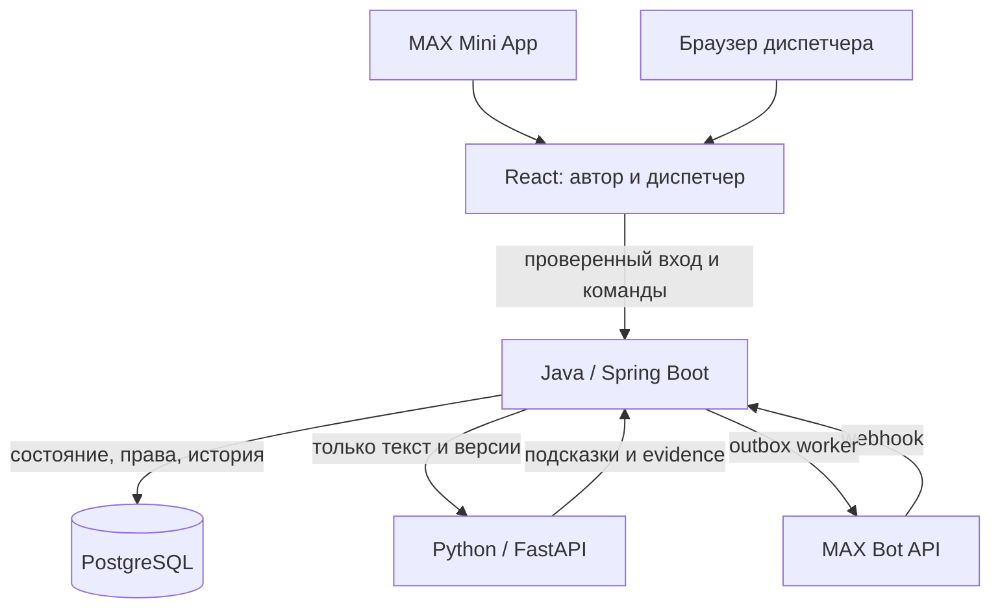
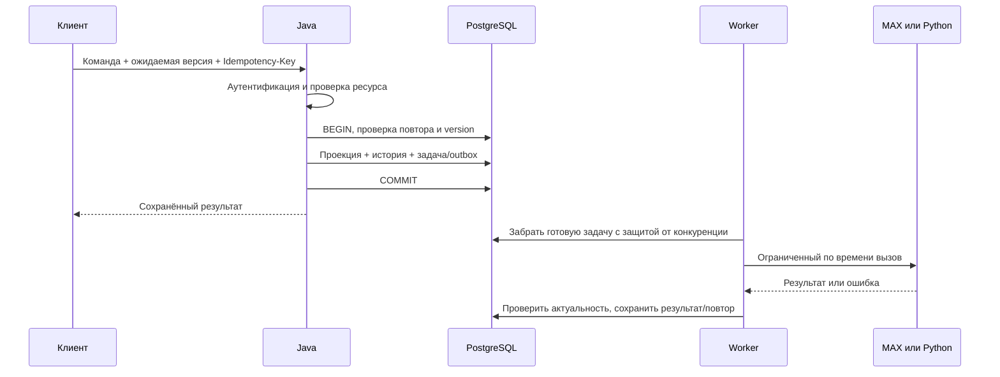

# Архитектура КОРНЯ

## Выбранная структура

Один Java-монолит по предметным пакетам, один stateless Python-сервис анализа, один React-клиент и PostgreSQL. Так два backend-разработчика работают с одной транзакционной моделью, а Никита может независимо менять NLP.

Это целевая схема MVP. В текущем каркасе работает чтение синтетического обращения и вызов STUB через Java; рабочие команды, MAX и workers ещё не включены.

Подробная реализация и недостающая схема - [implementation.md](implementation.md). Независимые задачи и границы контрактов троих - [parallel-development.md](parallel-development.md). Пример последовательности с конкретными версиями - [worked-example.md](worked-example.md).

## Пакеты и зависимости

| Место | Ответственность | Владелец | Уже есть |
|---|---|---|---|
| `backend/.../cases/domain` | Чистые правила пунктов и расчёт прогресса | Семён | `ItemState`, `CaseProgress`, тесты |
| `backend/.../cases/application` | Use cases, транзакции, проверка прав и версий | Семён | Граница пакета, реализация S1 |
| `backend/.../cases/persistence` | SQL и отображение данных | Семён | Граница пакета, миграции уже есть отдельно |
| `backend/.../identity` | MAX-аккаунт → внутренний пользователь → сессия | Кирилл | Граница пакета, K1 |
| `backend/.../max` | HTTP Bot API, webhook, обработка входных событий | Кирилл | Граница пакета, K5 |
| `backend/.../reports` | Отчёт и подтверждённые связи с пунктами | Семён | Граница пакета, S2 |
| `backend/.../observations` | Авторские наблюдения и корректировки | Семён | Граница пакета, S3 |
| `backend/.../notifications` | Обработка inbox/outbox | Семён + Кирилл | Таблица outbox, граница пакета, S5/K5 |
| `backend/.../inference` | Типизированный вызов, проверка evidence/версий, fallback | Семён | Реальный HTTP client и validator |
| `backend/.../demo` | Изолированный пример соединения сервисов | Кирилл | Только чтение фиксированных данных |
| `frontend/src/api` | Единственная точка HTTP-вызовов | Кирилл | Клиент demo API |
| `frontend/src/platform` | Адаптер MAX Bridge | Кирилл | Чтение сырой строки; авторизации нет |
| `ml/app` | Строгий контракт анализа, STUB, затем NLI | Никита | FastAPI, валидируемый запрос, честный отказ |

Направление внутри Java: HTTP → application service → domain/persistence. Domain не импортирует Spring и не знает о Python/MAX. Интерфейс не вычисляет рабочий статус самостоятельно. Преждевременные общие `BaseService`, `AbstractRepository` и микросервисы по каждому пакету не нужны.

## Хранение

`V1__initial_schema.sql` создаёт:

- `app_user`, `house`, `membership`: аккаунты и роль в конкретном доме.
- `service_case`, `case_revision`: обращение, версия конкурентного изменения, исходный текст каждой редакции.
- `case_item`, `item_revision`: актуальная проекция пункта и версии его подтверждаемого содержания.
- `work_report`, `report_item_link`: неизменяемый ответ, человек, подтвердивший связь, версия пункта и раунд.
- `resident_observation`: автор, источник, версия, раунд и наблюдение.
- `model_suggestion`: отдельно хранимая незаверенная подсказка.
- `audit_event`: история предметных команд.
- `outbox_event`: надёжная постановка уведомления в той же транзакции.
- `processed_command`: идемпотентность по actor + operation + key.

`V2__durable_webhook_inbox.sql` добавляет очередь входящих событий и уникальный event_key; обработчик и worker будут в K5/S5.

Составные FK не дают связать отчёт с пунктом другого обращения или записать наблюдение за другого автора. `CHECK` требует причину архива/отзыва. Текущая редакция ссылается на таблицу редакций через `DEFERRABLE INITIALLY DEFERRED`: обе строки создаются в одной транзакции и проверяются при commit.

Схема не заменяет полномочия Java. Она сама не доказывает роль исполнителя, актуальность callback или append-only доступ. Историю писать добавлением записей, а текущую проекцию менять с optimistic lock. Назначение исполнителя/область отчёта, opt-out, lease и надёжные analysis jobs дополняются миграциями; их наличие сейчас не заявляется. Для одной Java-инстанции в K1 планируется штатная HttpSession без собственной таблицы; рестарт требует нового входа, но не теряет сохранённые обращения.

## Граница транзакции

Не держать сетевой вызов внутри транзакции. На старте достаточно workers в том же Java-процессе и PostgreSQL `FOR UPDATE SKIP LOCKED` для короткого захвата с сохранением lease/token до commit; одна строковая блокировка не защищает вызов после commit. Отдельный брокер не нужен. Это план S4/S5, а не текущий работающий worker. После ошибки - ограниченное число попыток, backoff и видимый ручной разбор. Exactly-once для внешней доставки не обещается.

Webhook возвращает 200 после надёжного сохранения события в inbox, но до долгой обработки. Это закрывает окно потери при падении процесса после ответа MAX. Отправка outbox и обработка inbox проектируются отдельно; выборка из таблицы не считается успешной доставкой.

## Доверие и эксплуатация

1. Сырой `initData` проверяет Java по актуальной документации MAX. MAX подтверждает аккаунт, а Membership - роль в доме. Клиентский `userId` не является аутентификацией.
2. На чтениях и изменениях проверяются дом и автор/назначение. Угадываемость UUID не даёт доступа.
3. Python не получает креденшелы БД и не опубликован отдельным портом Compose. Сервис возвращает только типизированное предложение.
4. Evidence - точный фрагмент актуального исходного текста. Индексы во всех контрактах - Unicode code points. Java/JavaScript используют преобразование из UTF-16.
5. Секреты и полные тексты не пишутся в логи. Исключения inference логируются только по классу. Ошибка валидации Python не отражает тело запроса.
6. Пока нет настоящего входа, рабочие маршруты закрыты. Для примера существует явный profile `demo`, включаемый также группой `local` вместе с `no-db`.
7. Compose - локальная среда с портами на loopback. Публичная среда требует HTTPS, рабочего входа, отключённого demo, ограничений тела/частоты, резервного копирования и согласованных правил хранения.

## Решения по сложности

Spring JDBC выбран для явных транзакций и проверки версии в SQL. JPA, BPMN-движок, Kafka, Redis, векторная БД и Kubernetes пока не уменьшают необходимую работу для трёх человек. SSR не нужен для этих экранов. MAX UI можно подключить после проверки peerDependencies; базовые доступные HTML-компоненты уже работают без него.

Одна предметная подсистема выделяется в отдельный сервис только при доказанной потребности в независимом развёртывании/нагрузке. Python уже выделен из-за ML-экосистемы и отдельного владельца. [Обоснования решений](memory/DECISIONS.md).
