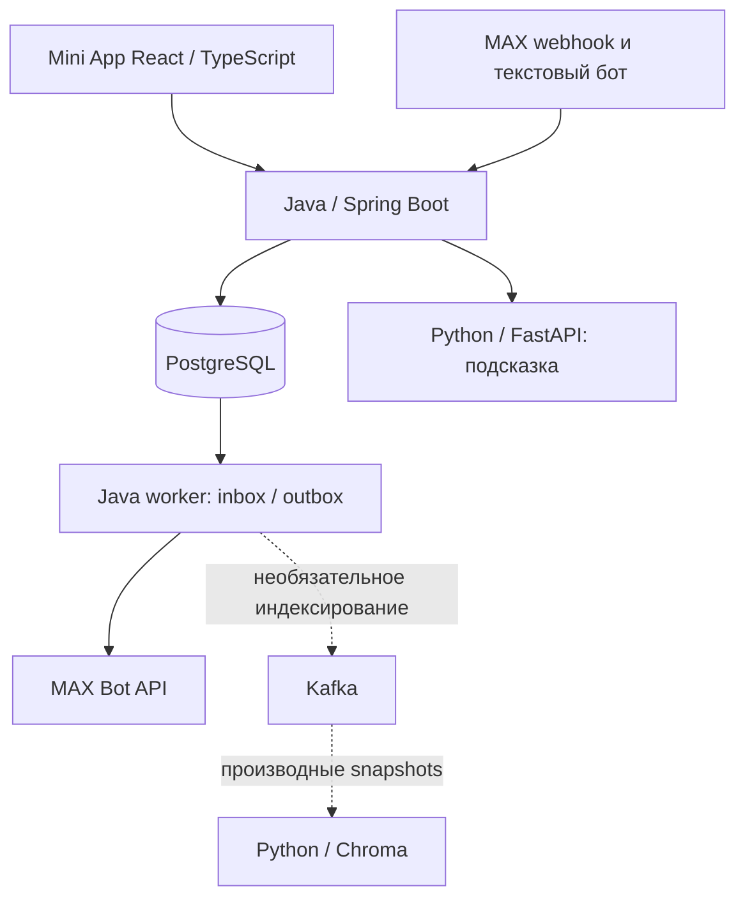

# Архитектура и ответственность

## Единый путь команд

Java проверяет сессию/получателя, Membership, видимость сущности и версию; исполняет команду, записывает аудит/результат идемпотентности/очередь атомарно. React и бот вызывают одинаковые application-сервисы. Python интерпретирует текст, но не подтверждает ремонт и не читает PostgreSQL.

## Существующие точки расширения

| Путь от корня | Реальный статус | Что достроить |
|---|---|---|
| `backend/.../cases/application/CaseService.java` | Внутренний CRUD/confirm с транзакциями | HTTP, приём и следующие шаги |
| `backend/.../cases/persistence/CaseRepository.java` | SQL и выборки ядра | Дополнительные проекции/команды с теми же проверками |
| `backend/.../cases/domain/` | ItemState и CaseProgress | Сохранять единый расчёт результата |
| `backend/.../identity/` | Валидатор MAX и provisioner | Сессия, `/me`, приглашения, отзыв Membership |
| `backend/.../config/SecurityConfig.java` | denyAll кроме health/demo | Точечные правила после реализации входа |
| `backend/.../reports/`, `observations/`, `notifications/`, `max/` | Только package-info | Настоящие команды/адаптеры, без дублирования CaseService |
| `backend/.../inference/` | HTTP, валидаторы, fallback, кандидаты/Kafka | Актуальность snapshot на пользовательском пути |
| `ml/app/features/` | Intake, compare STUB/RULES, index | Исправить смешанные субъекты, оценить воздержание |
| `frontend/src/` | Учебный экран | Рабочие сценарии из дизайна на согласованном API |

Здесь `backend/.../` означает `backend/src/main/java/ru/koren/`, а не существующий путь с буквальным многоточием.

## Развёртывание

Один HTTPS origin: `/` - статическая сборка Mini App, `/api/v1` - Java API, `/max/webhook` - вход событий MAX. Последний путь не находится под `/api/v1`. Python, PostgreSQL, Kafka/Chroma не доступны из браузера и публичного интернета. Токен MAX только на сервере. Vite dev server и profile local/demo/no-db не выходят на публичный домен.

Основной runtime остаётся модульным Java-монолитом с PostgreSQL и внутренним Python. Новая release-конфигурация с необязательным индексом - задача, а не уже существующий режим Compose. Сначала доказать ручной основной путь; не добавлять брокер или новый сервис там, где существующей таблицы очереди достаточно.

## Сессия и доверие

Основной проектный вариант - серверная cookie-сессия, HTTPS, CSRF для команд, один origin. До закрепления транспорта проверить cookies в настоящих mobile/web MAX. Если web-контекст блокирует такой вариант, выбрать один поддерживаемый транспорт с непрозрачным серверным токеном и обновить API/тесты. Не реализовывать две auth-системы заранее.

Уникальный MAX user ID определяет пользователя только после валидации сырого initData. Членство/роль подтверждает Java. Вход не создаёт повышенную роль автоматически. Отзыв доступа проверяется и на чтении, и на записи, и перед возвратом сохранённого результата повтора.

## Надёжность без второй модели

SQL-транзакция включает изменение агрегата, audit, processed_command и outbox. Сеть вне транзакции. Worker имеет ограниченную попытку, lease и восстановление после падения; отправка MAX не является частью подтверждения ремонта. Callback привязан к адресату/сущности/версиям, не к доверенным параметрам кнопки. После внешнего анализа Java повторно проверяет snapshot.

Применённые V1/V2 неизменны. Расширения схемы отдельными миграциями: членство, приглашение, приём, nextAction, worker metadata по фактической необходимости. Схему и DTO менять вместе с тестами обновления существующей БД.
