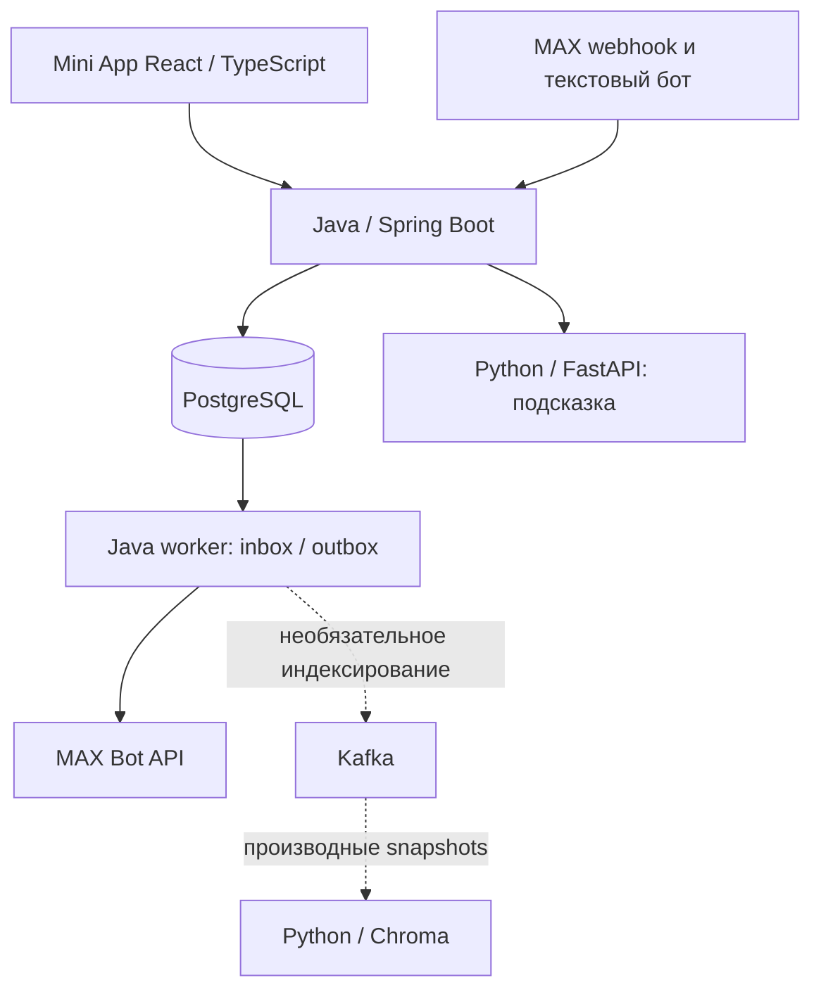

# Архитектура и ответственность

## Владение состоянием frontend

React Router управляет маршрутами и блокировкой ухода с несохранённой формы. TanStack Query хранит серверные проекции, отменяет старые запросы и обновляет связанные списки после команды. Эти две зависимости заменяют отдельную самописную маршрутизацию и кэш.

Форма получает свежий snapshot при открытии; после 409 сохраняет ввод, показывает актуальную версию и требует явного принятия контекста. Неизвестный исход хранит сериализованное тело и тот же Idempotency-Key в памяти до повтора; автоматического повтора команд нет. Старый идемпотентный ответ не откатывает cache на меньшую caseVersion. localStorage содержит только тему/размер текста.

`allowedActions` пока не реализован. Видимость действий использует `/me.memberships` и отношение `authorId === me.userId`; это интерфейсная подсказка, Java повторно проверяет все права. Роли, результаты и версии не задаются URL или клиентским текстом.

## Единый путь команд

Java проверяет сессию/получателя, Membership, видимость сущности и версию; исполняет команду, записывает аудит/результат идемпотентности/очередь атомарно. React и бот вызывают одинаковые application-сервисы. Python интерпретирует текст, но не подтверждает ремонт и не читает PostgreSQL.

## Существующие точки расширения

| Путь от корня | Реальный статус | Что достроить |
|---|---|---|
| `backend/.../cases/application/CaseService.java` | CRUD/confirm/приём/шаг/отчёт/связи/наблюдения/решения | Один владелец продуктовых команд; не дублировать на клиенте |
| `backend/.../cases/persistence/`, `cases/domain/` | SQL, версии, права, ItemState и CaseProgress | Сохранять серверный расчёт результата |
| `backend/.../identity/`, `config/SecurityConfig.java` | MAX HMAC, сессия, CSRF, memberships, приглашения, закрытые маршруты | Проверить реальный MAX web/mobile |
| `backend/.../max/`, `notifications/` | Webhook, диалог, durable inbox/outbox и HttpMaxSender | Контроль реальной доставки и повторов MAX |
| `backend/.../inference/` | HTTP, валидаторы, fallback, кандидаты/Kafka | Kafka-публикация CRUD ещё не подключена |
| `ml/app/features/` | Extract STUB, clarify RULES, compare RULES v2, производный индекс | Независимый holdout; не выдавать анализ за ремонт |
| `frontend/src/features/` | Автор, очередь, отчёты/связи, наблюдения, история | Приёмка Софии и живой MAX |
| `frontend/src/api/` | Generated OpenAPI types, cookie/CSRF client, Query cache, повторы | API не заменяется локальной моделью состояний |
| `frontend/src/components/`, `platform/max.ts` | ДомПульс, темы/текст/движение, формы, Bridge и защита ввода | Клавиатура и screen reader на физических устройствах |
| `compose.release.yaml`, `deploy/`, `frontend/nginx.conf` | Отдельная no-demo сборка, loopback proxy, опциональный HTTPS | Выпуск разрешён пользователем; backup, CI и smoke для конкретного SHA |

Здесь `backend/.../` означает `backend/src/main/java/ru/koren/`, а не существующий путь с буквальным многоточием.

## Развёртывание

Один HTTPS origin: `/` - статическая сборка Mini App, `/api/v1` - Java API, `/max/webhook` - вход событий MAX. Последний путь не находится под `/api/v1`. Python, PostgreSQL, Kafka/Chroma не доступны из браузера и публичного интернета. Токен MAX только на сервере. Vite dev server и profile local/demo/no-db не выходят на публичный домен.

Основной runtime остаётся модульным Java-монолитом с PostgreSQL и внутренним Python. `compose.release.yaml` запускает основной ручной путь без Kafka/Chroma; Python включается отдельным профилем `analysis`. Сначала доказать ручной основной путь; не добавлять брокер или новый сервис там, где существующей таблицы очереди достаточно.

## Сессия и доверие

Основной проектный вариант - серверная cookie-сессия, HTTPS, CSRF для команд, один origin. До закрепления транспорта проверить cookies в настоящих mobile/web MAX. Если web-контекст блокирует такой вариант, выбрать один поддерживаемый транспорт с непрозрачным серверным токеном и обновить API/тесты. Не реализовывать две auth-системы заранее.

Уникальный MAX user ID определяет пользователя только после валидации сырого initData. Членство/роль подтверждает Java. Вход не создаёт повышенную роль автоматически. Отзыв доступа проверяется и на чтении, и на записи, и перед возвратом сохранённого результата повтора.

## Надёжность без второй модели

SQL-транзакция включает изменение агрегата, audit, processed_command и outbox. Сеть вне транзакции. Worker имеет ограниченную попытку, lease и восстановление после падения; отправка MAX не является частью подтверждения ремонта. Callback привязан к адресату/сущности/версиям, не к доверенным параметрам кнопки. После внешнего анализа Java повторно проверяет snapshot.

Применённые V1/V2 неизменны. Расширения схемы отдельными миграциями: членство, приглашение, приём, nextAction, worker metadata по фактической необходимости. Схему и DTO менять вместе с тестами обновления существующей БД.
