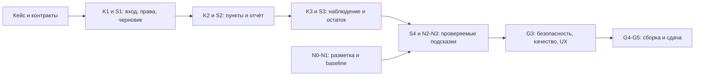

# Общий план на троих

Версия: 12.09.2026. Все задачи ниже - `TODO`, если не указано обратное в [текущем состоянии](memory/PROJECT_STATE.md).

## Организация

Кирилл совмещает Frontend, Java-вход через MAX и интеграцию. Семён владеет предметным Java-backend и БД. Никита владеет ML и доказательствами его полезности. Продуктовые решения принимает Кирилл после обсуждения втроём. Контракты между компонентами проверяют их два владельца.

План рассчитан примерно на 3-4 часа в день на человека. Оценки в персональных файлах - рабочие часы без ожидания доступов, с отдельным резервом последних дней. Если доступное время меньше, сокращать расширения, сохраняя основной путь и проверки.

## Этапы и результаты

Даты 15-30 сентября взяты из PDF и являются рабочим предположением. `T0` - фактическое получение задания; при изменении календаря сдвинуть этапы, сохранив порядок ворот.

| Этап | Рабочее окно | Кирилл | Семён | Никита | Критерий перехода |
|---|---|---|---|---|---|
| G0: постановка | T0-T1 / 15-16.09 | K0: кейс, доступы; K1: вход MAX | S0: контракты; S1: модель доступа и создание | N0: схема разметки, примеры | Трое запускают каркас; есть границы кейса и согласованные DTO |
| G1: ручной путь | T2-T4 / 17-19.09 | K2: автор; K3: диспетчер | S1-S3: обращения, отчёты, наблюдения | N1: baseline, разметка | Реальный CRUD и два пункта проходят процесс без ML; чужой пользователь отклоняется |
| G2: подсказки | T5-T7 / 20-22.09 | K3: проверка связей, состояния ошибок | S4: задачи анализа и валидация; S5: доставка | N2-N3: NLI и evidence | Человек принимает предложения; остановка ML не мешает сохранению; старая версия отклоняется |
| G3: доказательства | T8-T10 / 23-25.09 | K4: UX/MAX на устройствах | S6: гонки, повторы, чужой дом | N4-N5: отложенные тексты, задержки | Зафиксированы сборка, модель, набор и фактические метрики; критические сценарии проходят |
| G4: резерв | T11-T13 / 26-28.09 | K5: сборка, инструкция, видео | Исправления и независимый запуск | Анализ ошибок, таблица результатов | Третий участник разворачивает проект с нуля; подготовлен сценарий сбоя |
| G5: сдача | T14-T15 / 29-30.09 | Материалы и проверка формы сдачи | Контроль версии и доступности | Проверка формулировок метрик | Проверены фактические требования организаторов; материалы соответствуют сборке |

## Критический путь

Никита начинает независимо на `contracts/examples` и `ml/data/examples.jsonl`. Кирилл начинает UI на `/api/v1/demo/case`, затем переводит его на рабочие endpoints. Семён не ждёт модель для CRUD и правил.

## Владение общими файлами

| Область | Владелец | Обязательный второй читатель |
|---|---|---|
| Java-правила, SQL, рабочий REST | Семён | Кирилл |
| MAX, Java-аутентификация | Кирилл | Семён |
| `ml/`, разметка и оценка | Никита | Семён для протокола, Кирилл для UX |
| `contracts/` | Владелец изменения | Все затронутые потребители |
| `compose.yaml`, CI | Кирилл | Семён |
| Итоговые метрики | Никита | Кирилл и Семён |

Не редактировать одну миграцию одновременно. После первого общего запуска SQL менять новой миграцией. Один PR - один проверяемый результат; коммиты с коротким заголовком. Ветки `codex/<task-id>-<description>` или согласованный командой префикс. Слияние через review, без общего пароля или ветки с секретами.

## Ежедневный ритм

В начале дня 10 минут: что мешает критическому пути. В конце - один совместный сквозной запуск текущего результата. В `memory/PROJECT_STATE.md` фиксировать факт и проверку; в `HANDOFF.md` - того, кто продолжает, ID и входные данные.

## Ограничение объёма

Если к G1 нет ручного процесса, все помогают завершить его. Если к концу G2 он всё ещё нестабилен, заморозить расширения: генеративный ввод, фото, внешние интеграции. Отсутствие измеримой пользы NLI документировать честно, отдельно сверив обязательность ML в кейсе.

Нельзя сокращать проверки прав, сохранение черновика, контроль версий, восстановление после отказов и целостность пунктов ради дополнительных функций.
